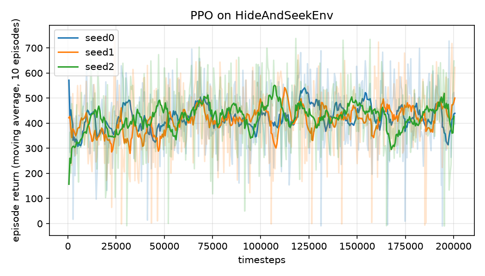
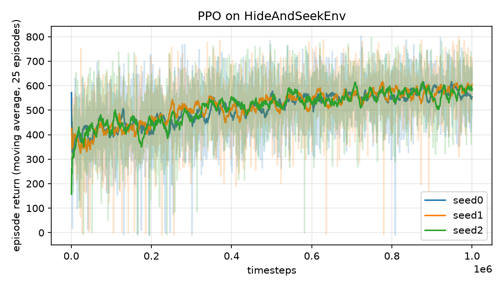

# HideAndSeekGym

A small 3D hide-and-seek environment with the Gymnasium API, and PPO baselines for it.

The agent is the hider: a point that moves in fixed steps inside a 10 m cube. A seeker is dropped
at a random spot and never moves. Every step the hider earns its distance from the seeker (scaled
by the stage size); walking into the seeker ends the episode with a penalty. Episodes are 500 steps.

It started in 2024 as a PyBullet environment. In October 2026 it was reworked so it trains without
PyBullet (which has no macOS arm64 wheel and fails to build from source there), the reward sign was
fixed, and baselines were actually run and recorded.

## Environment

| | |
|---|---|
| Observation | `Box(0, stage_size, (6,), float32)`: hider x, y, z, then seeker x, y, z |
| Actions | `Discrete(6)`: +y, -y, -x, +x, +z, -z, each one `increment` (0.1 m) |
| Reward | `distance(hider, seeker) / stage_size` per step, minus `catch_penalty` (10) on the step the hider is caught |
| Termination | distance < `catch_radius` (1 m) |
| Truncation | `max_steps` (500) |
| Reset | both bodies uniformly random in the cube, at least `catch_radius` apart; seeded through `reset(seed=...)` |

Constructor: `HideAndSeekEnv(stage_size=10.0, increment=0.1, catch_radius=1.0, max_steps=500,
catch_penalty=10.0, backend="numpy", render_mode=None)`.

Two backends hold the bodies and give identical dynamics:

- `backend="numpy"` (default): plain arrays. 20,000 random steps take 0.13 s on an M1 Pro.
- `backend="pybullet"`: the bodies are loaded into PyBullet so `render_mode="human"` shows them in
  the PyBullet GUI. Needs `pip install pybullet`. Physics is not used by either backend; positions
  are set directly, which is all the task needs.

The 2024 version used `reward = -distance`. Since the least negative return is the shortest
episode, that trains the hider to walk into the seeker. The curve looked like learning; the policy
was the opposite of the task.

## Install and run

```bash
python -m venv .venv && source .venv/bin/activate
pip install -r requirements.txt
python train.py --timesteps 200000 --seed 0 --out runs/seed0
python scripts/plot_curve.py runs/seed0 runs/seed1 runs/seed2 --out assets/learning_curve.png
```

`train.py` checks the environment with stable-baselines3's `check_env`, trains PPO (`MlpPolicy`,
`n_steps=1024`, `batch_size=64`, `n_epochs=4`, defaults otherwise), writes a Monitor CSV, saves the
model, and evaluates the greedy policy on 20 held-out seeds into `eval.json`.

## Results (2026-10-11, M1 Pro, CPU, stable-baselines3 2.9.0, gymnasium 1.4.0)

PPO, 200,000 timesteps per seed, about 400 episodes each:

| Seed | Mean return, first 10 episodes | Mean return, last 10 episodes | Greedy eval, 20 episodes |
|---|---|---|---|
| 0 | 331 | 440 | 407 ± 104 |
| 1 | 378 | 500 | 421 ± 162 |
| 2 | 320 | 427 | 434 ± 104 |

Reference policies on the same 20 evaluation seeds:

| Policy | Return |
|---|---|
| Uniform random actions | 303 ± 145 |
| Greedy move-away (pick the action that maximises distance now) | 562 ± 123 |



PPO, 1,000,000 timesteps per seed (about 2,000 episodes each, roughly 40 minutes per seed):

| Seed | Mean return, first 25 episodes | Mean return, last 25 episodes | Greedy eval, 20 episodes |
|---|---|---|---|
| 0 | 384 | 554 | 496 ± 104 |
| 1 | 372 | 605 | 521 ± 101 |
| 2 | 374 | 586 | 505 ± 101 |



So at 200k steps PPO is clearly better than random and clearly short of the one-line heuristic; at
1M steps it reaches about 90 percent of the heuristic's return and is still improving slowly. That
is the honest state of the baseline, not a solved environment. Observation normalisation (positions
are 0 to 10, unscaled), a larger step size and a moving seeker are the obvious next experiments.

## Layout

```
agentsim.py            HideAndSeekEnv and the two backends
train.py               PPO training + evaluation (argparse)
scripts/plot_curve.py  learning curves from Monitor CSVs
assets/                learning curves (200k and 1M steps)
requirements.txt       pinned versions used for the results above
```

## Limitations

- The seeker does not move and there are no obstacles, so "hiding" is "getting far away".
- Single agent. A moving seeker or a second learned agent would make it a real hide-and-seek task.
- Rendering requires PyBullet, which is optional and not installable from wheels on Apple Silicon.

## License

MIT, see `LICENSE`.
