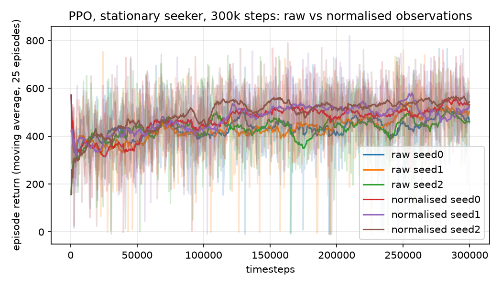
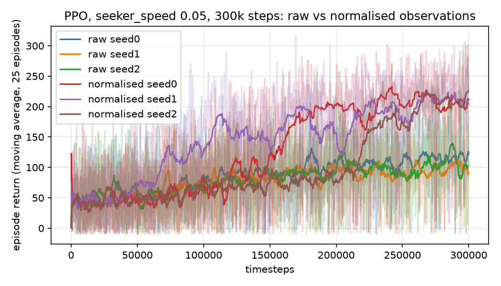
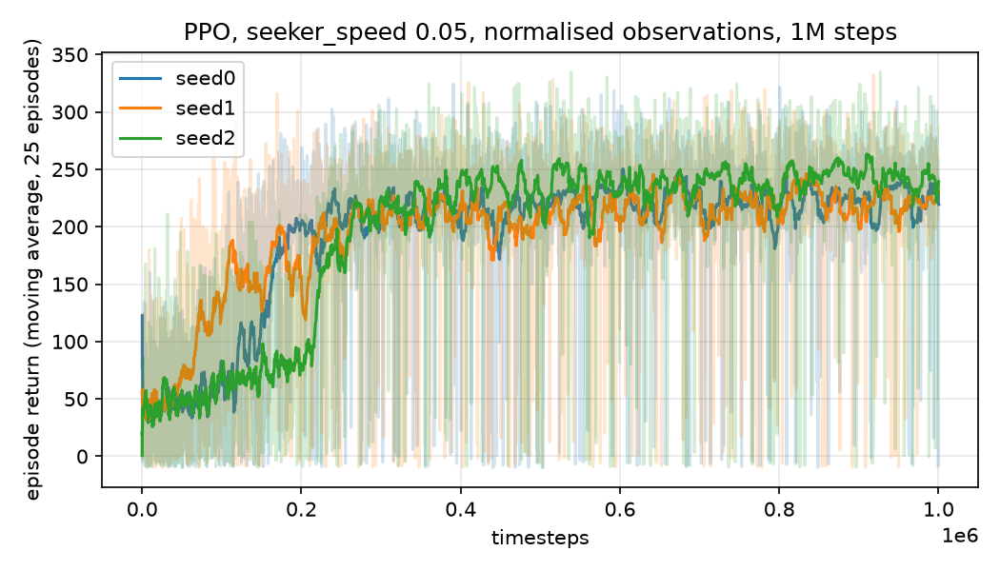
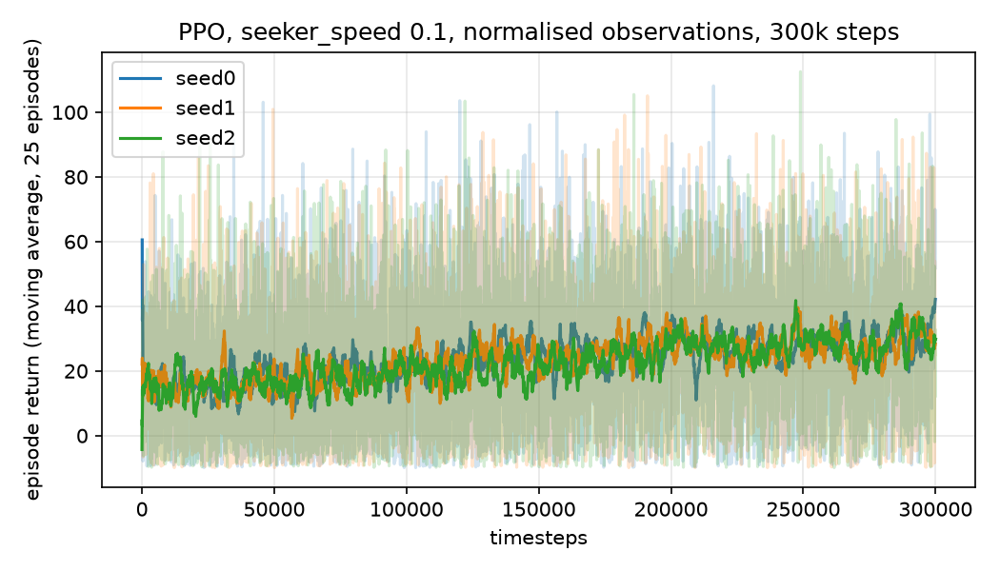

# HideAndSeekGym

A small 3D hide-and-seek environment with the Gymnasium API, and PPO baselines for it.

The agent is the hider: a point that moves in fixed steps inside a 10 m cube. A seeker is dropped
at a random spot and, by default, never moves; with `seeker_speed > 0` it walks straight toward the
hider every step. Every step the hider earns its distance from the seeker (scaled by the stage
size); being caught ends the episode with a penalty. Episodes are at most 500 steps.

It started in 2024 as a PyBullet environment. In October 2026 it was reworked so it trains without
PyBullet (which has no macOS arm64 wheel and fails to build from source there), the reward sign was
fixed, and baselines were actually run and recorded.

## Environment

| | |
|---|---|
| Observation | `Box(0, stage_size, (6,), float32)`: hider x, y, z, then seeker x, y, z |
| Actions | `Discrete(6)`: +y, -y, -x, +x, +z, -z, each one `increment` (0.1 m) |
| Reward | `distance(hider, seeker) / stage_size` per step, minus `catch_penalty` (10) on the step the hider is caught |
| Seeker | stays put when `seeker_speed` is 0 (default); otherwise, after the hider's move, it moves `seeker_speed` metres straight toward the hider's new position (never past it), clipped to the stage |
| Termination | distance < `catch_radius` (1 m) |
| Truncation | `max_steps` (500) |
| Reset | both bodies uniformly random in the cube, at least `catch_radius` apart; seeded through `reset(seed=...)` |

Constructor: `HideAndSeekEnv(stage_size=10.0, increment=0.1, catch_radius=1.0, max_steps=500,
catch_penalty=10.0, seeker_speed=0.0, backend="numpy", render_mode=None)`.

Two backends hold the bodies and give identical dynamics:

- `backend="numpy"` (default): plain arrays. 20,000 random steps take 0.13 s on an M1 Pro.
- `backend="pybullet"`: the bodies are loaded into PyBullet so `render_mode="human"` shows them in
  the PyBullet GUI. Needs `pip install pybullet`. Physics is not used by either backend; positions
  are set directly, which is all the task needs.

The 2024 version used `reward = -distance`. Since the least negative return is the shortest
episode, that trains the hider to walk into the seeker. The curve looked like learning; the policy
was the opposite of the task.

## Install and run

```bash
python -m venv .venv && source .venv/bin/activate
pip install -r requirements.txt
python train.py --timesteps 200000 --seed 0 --out runs/seed0
python train.py --timesteps 300000 --seed 0 --seeker-speed 0.05 --normalize --out runs/moving005/seed0
python scripts/plot_curve.py runs/seed0 runs/seed1 runs/seed2 --out assets/learning_curve.png
python scripts/baselines.py            # random and move-away heuristic for seeker_speed 0, 0.05, 0.1
pip install pytest && pytest           # environment tests, also run by the GitHub Actions workflow
```

`train.py` checks the environment with stable-baselines3's `check_env`, trains PPO (`MlpPolicy`,
`n_steps=1024`, `batch_size=64`, `n_epochs=4`, defaults otherwise), writes a Monitor CSV, saves the
model, and evaluates the greedy policy on 20 held-out seeds into `eval.json`. `--seeker-speed` and
`--increment` are passed to the environment. `--normalize` wraps training in `VecNormalize`
(observations only, rewards untouched); the running statistics are saved to `vecnormalize.pkl` next
to the model and reloaded for the evaluation, which is how the saved model must be used.

Training is CPU-bound on a tiny network: one process does 3,000-3,500 steps per second on the M1 Pro
(8192-step check, with torch's default 8 threads or with `OMP_NUM_THREADS=1`), so a 300k-step run is
about two minutes, and several seeds can run in parallel, one per core, with `OMP_NUM_THREADS=1`.

## Results (2026-10-11, M1 Pro, CPU, stable-baselines3 2.9.0, gymnasium 1.4.0)

PPO, 200,000 timesteps per seed, about 400 episodes each:

| Seed | Mean return, first 10 episodes | Mean return, last 10 episodes | Greedy eval, 20 episodes |
|---|---|---|---|
| 0 | 331 | 440 | 407 ± 104 |
| 1 | 378 | 500 | 421 ± 162 |
| 2 | 320 | 427 | 434 ± 104 |

Reference policies on the same 20 evaluation seeds:

| Policy | Return |
|---|---|
| Uniform random actions | 303 ± 145 |
| Greedy move-away (pick the action that maximises distance now) | 562 ± 123 |


PPO, 1,000,000 timesteps per seed (about 2,000 episodes each, roughly 40 minutes per seed):

| Seed | Mean return, first 25 episodes | Mean return, last 25 episodes | Greedy eval, 20 episodes |
|---|---|---|---|
| 0 | 384 | 554 | 496 ± 104 |
| 1 | 372 | 605 | 521 ± 101 |
| 2 | 374 | 586 | 505 ± 101 |


So at 200k steps PPO is clearly better than random and clearly short of the one-line heuristic; at
1M steps it reaches about 90 percent of the heuristic's return and is still improving slowly. That
is the honest state of the baseline, not a solved environment. Observation normalisation (positions
are 0 to 10, unscaled), a larger step size and a moving seeker were the obvious next experiments;
they are in the next section.

## Moving seeker, observation normalisation, step size (2026-10-12, Apple M1 Pro, CPU)

Same PPO settings, library versions and 20 evaluation seeds as above, three seeds per setting,
`OMP_NUM_THREADS=1` with nine runs in parallel; a 300k-step run took 95 s without normalisation and
about 125 s with it, a 1M-step run about 6 minutes. Reference policies come from
`scripts/baselines.py` on the same seeds. Its random policy draws actions from the environment's
seeded RNG, which is why its stationary figure (317) differs from the 303 above, which used an
unseeded sampler; the heuristic figure is identical. "First 25" and "last 25" are the mean training
return over the first and last 25 episodes of each seed; the bracket after each evaluation figure is
the number of the 20 evaluation episodes in which the hider was caught.

| Seeker speed (m/step) | Hider step (m) | Obs. normalised | Steps per seed | First 25 episodes (seeds 0 / 1 / 2) | Last 25 episodes (seeds 0 / 1 / 2) | Greedy eval, 20 episodes (caught) | Random | Heuristic |
|---|---|---|---|---|---|---|---|---|
| 0 | 0.1 | no | 300k | 384 / 372 / 374 | 469 / 502 / 460 | 424 ± 103 (0) / 439 ± 156 (1) / 437 ± 104 (0) | 317 ± 137 | 562 ± 123 |
| 0 | 0.1 | yes | 300k | 377 / 361 / 357 | 531 / 526 / 543 | 451 ± 106 (0) / 465 ± 100 (0) / 475 ± 95 (0) | 317 ± 137 | 562 ± 123 |
| 0 | 0.2 | yes | 300k | 383 / 375 / 371 | 547 / 535 / 572 | 446 ± 100 (0) / 462 ± 102 (0) / 502 ± 91 (0) | 323 ± 124 | 575 ± 125 |
| 0.05 | 0.1 | no | 300k | 49 / 45 / 45 | 122 / 92 / 102 | 125 ± 61 (18) / 93 ± 63 (20) / 121 ± 68 (20) | 36 ± 44 | 114 ± 53 |
| 0.05 | 0.1 | yes | 300k | 49 / 46 / 47 | 212 / 204 / 225 | 225 ± 34 (0) / 210 ± 77 (2) / 214 ± 54 (1) | 36 ± 44 | 114 ± 53 |
| 0.05 | 0.1 | yes | 1M | 49 / 46 / 47 | 219 / 231 / 239 | 231 ± 31 (0) / 206 ± 83 (3) / 243 ± 36 (0) | 36 ± 44 | 114 ± 53 |
| 0.1 | 0.1 | yes | 300k | 19 / 17 / 17 | 42 / 28 / 30 | 29 ± 24 (20) / 32 ± 25 (20) / 32 ± 26 (20) | 13 ± 22 | 40 ± 28 |

With a moving seeker both reference policies are caught in every evaluation episode: at speed 0.05
the random policy lasts 106 steps on average and the heuristic 225; at 0.1 they last 52 and 119.
The heuristic, which always steps directly away, ends every one of those episodes in a corner, all
three coordinates at a wall.

Stationary seeker, 300k steps, with and without observation normalisation:



Seeker at 0.05 m/step, 300k steps, with and without observation normalisation:



Seeker at 0.05 m/step, normalised observations, 1M steps:



Seeker at 0.1 m/step (equal to the hider), normalised observations, 300k steps:



With the stationary seeker, normalising the observations is worth a modest, consistent amount at
300k steps: greedy evaluation 451-475 against 424-439 without it, last-25-episode training return
526-543 against 460-502, still short of the heuristic (562) and of the un-normalised 1M-step runs
above (496-521). The remaining gap has a simple shape: the heuristic ends every episode in a corner,
11.2 m from the seeker on average, while the normalised seed-0 policy ends on a face of the cube with
one coordinate at a wall, at 9.0 m. With a seeker chasing at half the hider's speed, normalisation is
the difference between failing and not: without it PPO reaches the heuristic's level after 300k
steps (93-125) and is caught in 18-20 of the 20 evaluation episodes; with it the hider is caught in
0-2 of 20 and returns 210-225, about twice the heuristic, and a further 700k steps add little
(206-243), so that is roughly where this configuration plateaus. A return of about 220 over 500 steps
is a mean distance of 4.4 m: the hider can no longer sit 9-11 m away as it does from a stationary
seeker, and the evaluated policies instead keep a buffer, never closer than 2.3-2.5 m in the episodes
they survive, with on average 0.6-0.9 of the hider's three coordinates at a wall against 2.0 for the
heuristic. At `seeker_speed` 0.1, equal to the hider's, nothing evades: random, heuristic and PPO are
caught in every episode, and PPO (29-32, about 100 steps) is below the heuristic (40, 119 steps)
after 300k steps. That is a property of the task rather than of the learner: an axis-aligned 0.1 m
step can increase the distance by at most 0.1 m and the seeker then closes exactly 0.1 m, so the
distance never grows and the episode is only a question of how long the chase takes.

Doubling the hider's step to 0.2 m (stationary seeker, normalised) raises the training return a
little, 535-572 over the last 25 episodes against 526-543, since the hider reaches the far side of
the cube in half the steps, and leaves the evaluation (446-502) within seed-to-seed noise of the
0.1 m runs (451-475); the heuristic gains similarly (575 against 562). It does not change the picture.

## Layout

```
agentsim.py              HideAndSeekEnv and the two backends
train.py                 PPO training + evaluation (argparse)
scripts/plot_curve.py    learning curves from Monitor CSVs
scripts/baselines.py     random and greedy move-away reference policies on the evaluation seeds
tests/test_env.py        pytest suite for the environment (run in CI, .github/workflows/tests.yml)
assets/                  learning curves
requirements.txt         pinned versions used for the results above
```

## Limitations

- By default the seeker does not move; with `seeker_speed` it chases in a straight line with no
  prediction, the simplest possible pursuer. There are no obstacles and no line of sight, so hiding
  is running.
- At `seeker_speed` equal to `increment` the hider cannot increase the distance with axis-aligned
  moves (see above), so that setting measures survival time, and with a 1 m catch radius it is short.
- Single agent. A learned seeker would make it a real hide-and-seek task.
- Evaluation is 20 episodes with standard deviations of 30-160, so differences of a few tens of
  points between seeds or settings are not meaningful. The normalisation effect with a stationary
  seeker is at that scale; the effect with a chasing seeker is not.
- Rendering requires PyBullet, which is optional and not installable from wheels on Apple Silicon.

## Next steps

- A learned seeker (alternating or self-play training), or at least a pursuer that aims at where
  the hider is heading.
- Obstacles or occlusion, so that the reward depends on being out of sight rather than far away.
- Seeker speeds between 0.05 and 0.1 to find where evasion stops being possible, and diagonal or
  continuous hider moves, which remove the equal-speed argument above.
- Longer normalised training with the stationary seeker, to see whether PPO ever leaves the face of
  the cube for the corner.

## License

MIT, see `LICENSE`.
